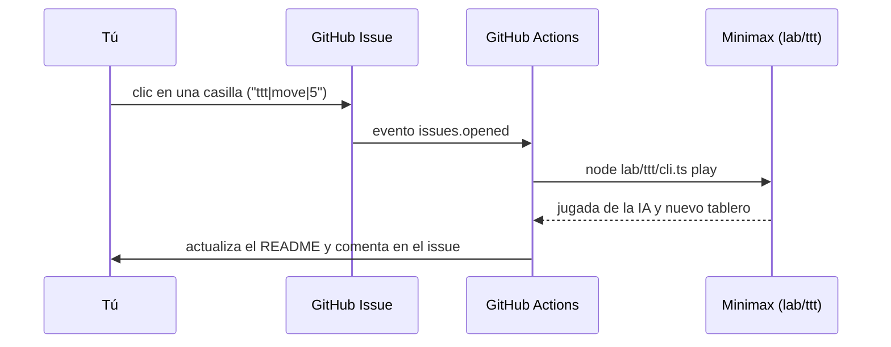

<div align="center">


</div>

> [!TIP]
> **Todo lo que se mueve en este perfil lo genera mi propio código**: TypeScript puro, sin librerías, en [`lab/`](lab). GitHub Actions lo regenera cada 6 horas, así que cada visita puede traer una carrera y un laberinto nuevos. Abre los **«¿Cómo funciona?»** para ver la teoría detrás de cada animación.

<details>
<summary><b>🍩 ¿Cómo funciona el donut del encabezado?</b></summary>

<br>

Es mi versión de [`donut.c`](https://www.a1k0n.net/2011/07/20/donut-math.html): un toro 3D dibujado solo con caracteres ASCII.

1. **Geometría:** un círculo de radio $R_1$ desplazado $R_2$ del centro gira alrededor del eje Y y forma el toro.
2. **Rotación:** cada punto se multiplica por las matrices de rotación de los ángulos $A$ (eje X) y $B$ (eje Z).
3. **Proyección:** un punto 3D cae en la pantalla en $x' = \frac{K_1\,x}{z}$ y $y' = \frac{K_1\,y}{z}$, así que lo lejano se ve más pequeño.
4. **Z-buffer:** en cada celda se guarda $1/z$ y solo se pinta el punto más cercano.
5. **Iluminación:** el producto punto entre la normal de la superficie y la luz da un brillo que se traduce a un carácter: `.,-~:;=!*#$@`.

Se precalculan 48 cuadros y el SVG muestra uno a la vez con CSS. Código: [`lab/header.ts`](lab/header.ts).

</details>

---

### 🏁 Carrera de ordenamiento


<details>
<summary><b>¿Cómo funciona? Abre para aprender 🤓</b></summary>

<br>

Los cuatro algoritmos ordenan **exactamente el mismo arreglo**. El reloj avanza **un tick por comparación**, así que la animación muestra el trabajo real de cada uno y no depende de la velocidad de la máquina. Los triángulos blancos señalan las dos posiciones que se están comparando.

| Algoritmo | Idea | Mejor | Promedio | Peor | Memoria | ¿Estable? |
|---|---|:-:|:-:|:-:|:-:|:-:|
| **Bubble Sort** | Intercambia vecinos desordenados hasta que no queda ninguno | $O(n)$ | $O(n^2)$ | $O(n^2)$ | $O(1)$ | ✅ |
| **Insertion Sort** | Toma cada elemento y lo inserta en su lugar dentro de la parte ya ordenada | $O(n)$ | $O(n^2)$ | $O(n^2)$ | $O(1)$ | ✅ |
| **Merge Sort** | Divide en mitades, ordena cada una y las mezcla | $O(n \log n)$ | $O(n \log n)$ | $O(n \log n)$ | $O(n)$ | ✅ |
| **Quick Sort** | Elige un pivote, pone los menores a la izquierda y repite en cada lado | $O(n \log n)$ | $O(n \log n)$ | $O(n^2)$ | $O(\log n)$ | ❌ |

**💡 Dato curioso:** con arreglos pequeños, Insertion Sort a veces le pelea a los $O(n \log n)$. Por eso TimSort (el `sort` de Python y el de objetos en Java) usa Insertion Sort para los tramos cortos.

**¿Cómo se anima?** Cada algoritmo corre sobre un `Tracker` que registra cada comparación y cada movimiento. Luego esos eventos se convierten en animaciones SMIL dentro del SVG:

```ts
less(i: number, j: number): boolean {
  this.marks.push({ t: this.t, i, j }); // queda registrado para la animación
  this.t++;                             // el reloj avanza 1 tick por comparación
  return this.vals[this.arr[i]] < this.vals[this.arr[j]];
}
```

Código: [`lab/sort.ts`](lab/sort.ts)

</details>

### 🧭 Búsqueda de caminos: BFS vs A*


<details>
<summary><b>¿Cómo funciona? Abre para aprender 🤓</b></summary>

<br>

Los dos encuentran **el camino más corto**, pero no exploran lo mismo:

- **BFS (búsqueda en anchura)** usa una cola FIFO y avanza en "anillos" de distancia: primero todo lo que está a 1 paso, luego a 2, y así. No sabe dónde está la meta, así que explora casi todo. Complejidad: $O(V + E)$.
- **A\*** usa una cola de prioridad (un *min-heap* binario que implementé a mano) ordenada por

$$f(n) = \underbrace{g(n)}_{\text{lo que ya caminé}} + \underbrace{h(n)}_{\text{lo que estimo que falta}}$$

La heurística es la distancia Manhattan $h(n) = |x_n - x_{meta}| + |y_n - y_{meta}|$. Como **nunca sobreestima** la distancia real (es *admisible*), A* sigue garantizando el camino óptimo y explora muchísimo menos.

**El laberinto** se genera con DFS + *backtracking*, que da un laberinto "perfecto" con un solo camino entre dos puntos. Después abro el 30 % de los muros internos al azar para crear ciclos y que haya varias rutas posibles.

Código: [`lab/path.ts`](lab/path.ts)

</details>

### 🌀 Series de Fourier


<details>
<summary><b>¿Cómo funciona? Abre para aprender 🤓</b></summary>

<br>

Cualquier curva cerrada se puede dibujar sumando **círculos que giran**. El proceso:

1. Recorro el contorno de la taza y lo muestreo en $N = 512$ puntos equidistantes. Cada punto es un número complejo $z_n = x_n + i\,y_n$.
2. Calculo la **Transformada Discreta de Fourier**:

$$c_k = \frac{1}{N}\sum_{n=0}^{N-1} z_n \, e^{-2\pi i k n / N}$$

3. Cada coeficiente $c_k$ es un círculo: su **radio** es $|c_k|$, su **velocidad** es $k$ vueltas por ciclo y su **ángulo inicial** es $\arg(c_k)$. Al sumarlos se recupera el dibujo:

$$z(t) = \sum_{k} c_k \, e^{2\pi i k t}$$

4. Ordeno los círculos de mayor a menor y uso solo los 60 más grandes de 512. Con pocos círculos sale la forma general y con más aparecen los detalles. Es la misma idea de representar una señal por sus frecuencias que usan JPEG y MP3.

**En el SVG** cada círculo es un `<g>` anidado dentro del anterior que gira con `animateTransform`. Así cada uno rota relativo a su padre a $k_i - k_{i-1}$ vueltas por ciclo.

Código: [`lab/fourier.ts`](lab/fourier.ts)

</details>

---

### 🎮 Juega contra mi IA

Haz clic en una casilla: se abre un issue con la jugada ya escrita, solo dale **Submit new issue**. En unos segundos mi IA responde, comenta en el issue y actualiza este tablero.

<!-- TTT:START -->
<div align="center">

<table>
<tr><td><a href="https://github.com/Juanka690/Juanka690/issues/new?title=ttt%7Cmove%7C1&body=%C2%A1Solo%20dale%20**Submit%20new%20issue**!%20%F0%9F%91%87%20Mi%20IA%20responder%C3%A1%20en%20unos%20segundos%20y%20el%20tablero%20del%20perfil%20se%20actualizar%C3%A1%20solo."></a></td><td><a href="https://github.com/Juanka690/Juanka690/issues/new?title=ttt%7Cmove%7C2&body=%C2%A1Solo%20dale%20**Submit%20new%20issue**!%20%F0%9F%91%87%20Mi%20IA%20responder%C3%A1%20en%20unos%20segundos%20y%20el%20tablero%20del%20perfil%20se%20actualizar%C3%A1%20solo."></a></td><td><a href="https://github.com/Juanka690/Juanka690/issues/new?title=ttt%7Cmove%7C3&body=%C2%A1Solo%20dale%20**Submit%20new%20issue**!%20%F0%9F%91%87%20Mi%20IA%20responder%C3%A1%20en%20unos%20segundos%20y%20el%20tablero%20del%20perfil%20se%20actualizar%C3%A1%20solo."></a></td></tr>
<tr><td><a href="https://github.com/Juanka690/Juanka690/issues/new?title=ttt%7Cmove%7C4&body=%C2%A1Solo%20dale%20**Submit%20new%20issue**!%20%F0%9F%91%87%20Mi%20IA%20responder%C3%A1%20en%20unos%20segundos%20y%20el%20tablero%20del%20perfil%20se%20actualizar%C3%A1%20solo."></a></td><td><a href="https://github.com/Juanka690/Juanka690/issues/new?title=ttt%7Cmove%7C5&body=%C2%A1Solo%20dale%20**Submit%20new%20issue**!%20%F0%9F%91%87%20Mi%20IA%20responder%C3%A1%20en%20unos%20segundos%20y%20el%20tablero%20del%20perfil%20se%20actualizar%C3%A1%20solo."></a></td><td><a href="https://github.com/Juanka690/Juanka690/issues/new?title=ttt%7Cmove%7C6&body=%C2%A1Solo%20dale%20**Submit%20new%20issue**!%20%F0%9F%91%87%20Mi%20IA%20responder%C3%A1%20en%20unos%20segundos%20y%20el%20tablero%20del%20perfil%20se%20actualizar%C3%A1%20solo."></a></td></tr>
<tr><td><a href="https://github.com/Juanka690/Juanka690/issues/new?title=ttt%7Cmove%7C7&body=%C2%A1Solo%20dale%20**Submit%20new%20issue**!%20%F0%9F%91%87%20Mi%20IA%20responder%C3%A1%20en%20unos%20segundos%20y%20el%20tablero%20del%20perfil%20se%20actualizar%C3%A1%20solo."></a></td><td><a href="https://github.com/Juanka690/Juanka690/issues/new?title=ttt%7Cmove%7C8&body=%C2%A1Solo%20dale%20**Submit%20new%20issue**!%20%F0%9F%91%87%20Mi%20IA%20responder%C3%A1%20en%20unos%20segundos%20y%20el%20tablero%20del%20perfil%20se%20actualizar%C3%A1%20solo."></a></td><td><a href="https://github.com/Juanka690/Juanka690/issues/new?title=ttt%7Cmove%7C9&body=%C2%A1Solo%20dale%20**Submit%20new%20issue**!%20%F0%9F%91%87%20Mi%20IA%20responder%C3%A1%20en%20unos%20segundos%20y%20el%20tablero%20del%20perfil%20se%20actualizar%C3%A1%20solo."></a></td></tr>
</table>

**¡Empieza tú!** Juegas con ❌: haz clic en cualquier casilla.

🧑 Humanos **0** · 🤖 IA **0** · 🤝 Empates **0**

</div>

<!-- TTT:END -->

<details>
<summary><b>¿Cómo piensa la IA? Abre para aprender 🤓</b></summary>

<br>

Usa **minimax con poda alfa-beta**: simula todas las partidas posibles a partir del tablero actual. En sus turnos elige la jugada de mayor valor y supone que tú siempre eliges la que más la perjudica.

- Ganar vale $10 - \text{profundidad}$: prefiere ganar rápido.
- Perder vale $\text{profundidad} - 10$: si va a perder, lo retrasa todo lo posible.
- Empatar vale $0$.

La **poda alfa-beta** descarta ramas que ya no pueden cambiar la decisión, así que analiza muchas menos posiciones que las 255.168 partidas posibles del triqui. Como juega perfecto, **lo mejor que puedes lograr es un empate**... ¿o no? 😏



Código: [`lab/ttt/engine.ts`](lab/ttt/engine.ts) · [`.github/workflows/ttt.yml`](.github/workflows/ttt.yml)

</details>

---

### 🐍 Mi culebrita de contribuciones

<div align="center">

<picture>
  <source media="(prefers-color-scheme: dark)" srcset="https://raw.githubusercontent.com/Juanka690/Juanka690/output/github-contribution-grid-snake-dark.svg" />
  <source media="(prefers-color-scheme: light)" srcset="https://raw.githubusercontent.com/Juanka690/Juanka690/output/github-contribution-grid-snake.svg" />
  
</picture>

<sub>Hecho con ☕ en Medellín :colombia: · todo el código está en este repo</sub>

</div>
